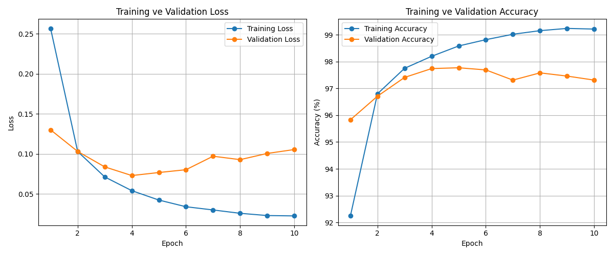
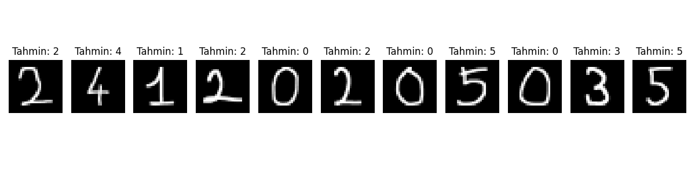

# MNIST Veri Seti ile MLP Tabanlı El Yazısı Rakam Tanıma

**Ad Soyad:** Mertcan Gündoğan  
**Öğrenci No:** 24120205035  
**Bölüm:** Bilgisayar Mühendisliği  

---
Bu projede MNIST veri seti kullanılarak sıfırdan bir Multi-Layer Perceptron (MLP) modeli eğitilmiş ve modelin başarısı test edilmiştir. Ayrıca eğitilen model, kendi el yazımla oluşturduğum öğrenci numarası rakamları (`24120205035`) üzerinde gerçek dünya verisi olarak denenmiştir.

## 1. Veri Seti ve Ön İşleme

Deneylerde `torchvision.datasets` üzerinden indirilen MNIST veri seti kullanılmıştır. Görüntüler 28x28 piksel boyutunda ve gri tonlamalıdır. Veriler modele verilmeden önce `ToTensor()` ile 0-1 aralığına çekilmiş ve MNIST standart ortalama/standart sapma değerleri `(0.1307, 0.3081)` ile normalize edilmiştir.

Veri seti aşağıdaki şekilde 3 ayrı kümeye bölünmüştür:
* **Training Set:** 50.000 görüntü (Modelin eğitimi için)
* **Validation Set:** 10.000 görüntü (Eğitim sırasında hiperparametre ve overfitting kontrolü için)
* **Test Set:** 10.000 görüntü (Eğitim bittikten sonra modelin hiç görmediği verilerle son başarısını ölçmek için)

## 2. Model Mimarisi ve Hiperparametreler

Ödev kuralları gereği CNN katmanları kullanılmamış, sadece tam bağlantılı (`nn.Linear`) katmanlardan oluşan temel bir MLP modeli kurulmuştur:

* **Giriş Katmanı:** 28x28 boyutundaki görüntüler `view(-1, 784)` ile 784 elemanlı tek boyutlu vektöre düzleştirilmiştir (Flatten).
* **1. Gizli Katman (Hidden Layer 1):** 784 -> 256 nöron + `ReLU` aktivasyonu
* **2. Gizli Katman (Hidden Layer 2):** 256 -> 128 nöron + `ReLU` aktivasyonu
* **Çıkış Katmanı (Output Layer):** 128 -> 10 sınıf (`0-9` arası rakamlar)

**Kullanılan Hiperparametreler:**
* **Loss Fonksiyonu:** CrossEntropyLoss
* **Optimizer:** Adam
* **Learning Rate:** 0.001
* **Batch Size:** 64
* **Epoch Sayısı:** 10
* **Çalıştırılan Cihaz:** CPU

## 3. Deney Sonuçları

Model 10 epoch boyunca eğitilmiş ve aşağıdaki sonuçlar elde edilmiştir:

| Metrik | Sonuç (10. Epoch Sonu) |
| :--- | :--- |
| **Training Loss** | 0.0227 |
| **Validation Loss** | 0.1055 (En düşük 4. Epoch: 0.0731) |
| **Training Accuracy** | %99.21 |
| **Validation Accuracy** | %97.31 (En yüksek 5. Epoch: %97.77) |
| **Test Accuracy** | **%97.26** |
| **Toplam Eğitim Süresi** | **53.93 saniye** |

### Loss ve Accuracy Grafikleri



**Sonuçların Yorumlanması:**
Eğitim sürecinde Training Loss düzenli olarak `0.2567`'den `0.0227`'ye kadar düşmüş ve Training Accuracy `%99.21`'e ulaşmıştır. Ancak Validation Loss değerine bakıldığında 4. epoch'a kadar (`0.0731`) düştüğü, 5. epoch'tan itibaren ise yavaşça `0.1055` seviyesine yükseldiği görülmektedir. Bu durum modelin 4-5. epoch'tan sonra eğitim verisini hafifçe ezberlemeye (overfitting) başladığını göstermektedir. Buna rağmen model, daha önce hiç görmediği 10.000 adetlik Test verisi üzerinde **%97.26** gibi yüksek bir doğruluk oranı yakalamıştır.

---

## 4. Kendi El Yazım ile Öğrenci Numarası Testi (`24120205035`)

Eğitilen modelin gerçek dünya verisi üzerindeki performansını görmek için öğrenci numaram olan **24120205035** rakamlarını kendi el yazımla çizip `numbers/` klasörüne kaydettim.

### Ön İşleme ve Distribution Shift Gözlemi
İlk denemede beyaz arka plan üzerine ince kalemle çizdiğim rakamların renklerini ters çevirip (`bitwise_not`) doğrudan 28x28 piksele küçülttüğümde, ince çizgilerdeki pikseller küçültme (downsampling) sırasında kayboldu ve kopuk noktalara dönüştü. Bu nedenle model neredeyse tüm rakamları `5` veya `1` olarak yanlış tahmin etti.

Eğitim verisi (MNIST) ile kendi çizdiğim görüntüler arasındaki bu dağılım farkını (**distribution shift**) çözmek için `numara_test.py` içerisinde şu ön işleme adımlarını uyguladım:
1. Görüntüler gri tonlamalı okunup arka plan siyah, yazı beyaz olacak şekilde ters çevrildi.
2. `cv2.threshold` ve `cv2.dilate` (morfolojik kalınlaştırma) uygulanarak ince çizgiler MNIST veri setindeki fırça kalınlığına benzetildi.
3. Rakamın etrafındaki gereksiz boşluklar kırpılıp oran bozulmadan 20x20 boyuta küçültüldü ve kenarlarına 4'er piksel siyah boşluk (padding) eklenerek 28x28 pikselin tam merkezine oturtuldu.
4. Son olarak MNIST standartlarında normalize edilerek modele verildi.

### Tahmin Sonucu

Bu ön işleme adımlarından sonra model öğrenci numaramın tamamını (**24120205035**) hatasız bir şekilde doğru tahmin etmiştir:



## 5. Kurulum ve Çalıştırma

Gerekli kütüphaneleri kurmak için:
```bash
pip install torch torchvision opencv-python matplotlib numpy
```
Kaydedilmiş model ağırlıkları (mlp_model.pth) üzerinden öğrenci numarası tahminini çalıştırmak için:
```bash
python number_test.py
```
